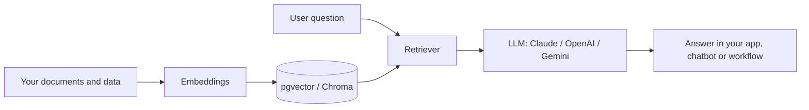

  

<h2 align="center">Hi , I'm Mahmoud</h2>

  

  I build web and mobile products end to end: databases and APIs, front ends, cross-platform apps, 
  and the AI and automation layers on top.

## 🙋‍♂️ About me

- 💼 Senior Full Stack Developer from Cairo, Egypt, with **11+ years** of experience
- 🌍 Built Arabic and bilingual products for clients in **Saudi Arabia, Oman and Iraq**
- 🤖 Building AI into real products: agents, RAG, MCP servers and chatbots
- 🧩 Building browser extensions for Chrome, Edge and Firefox
- 🧊 Creating interactive 3D on the web with Three.js
- 👯 Happy to collaborate on open-source projects
- ⚡ Fun fact: I play games and watch anime

## 🤖 AI engineering

- 🧠 **LLM features in real apps**: OpenAI, Claude, Gemini and DeepSeek APIs, plus local models with Ollama and Hugging Face
- 📚 **RAG**: chat with your own documents and data, with embeddings stored in pgvector or Chroma
- 🕹️ **AI agents**: multi-step agents with tool calling, built with LangChain and LangGraph
- 🔌 **MCP servers**: connect AI assistants to your own tools, APIs and databases
- ⚡ **AI in Next.js and React**: chat and AI features with the Vercel AI SDK
- 🔁 **AI automation**: n8n, Make and Zapier workflows with LLM steps
- 👨‍💻 **AI-assisted development**: Claude Code, Cursor and Antigravity in my daily workflow

**Models & platforms** 
 
OpenAI · Claude · Gemini · DeepSeek · Ollama · Hugging Face

**Agents, MCP & RAG** 
 
LangChain · LangGraph · Vercel AI SDK · MCP · pgvector · Chroma

**AI coding tools** 
 
Claude Code · Cursor · Antigravity

**Automation** 
 
n8n · Make · Zapier

<b>How a RAG feature works in my projects</b>

 

## 🛠️ Tech stack

**Backend** 

**Frontend & 3D** 

**Mobile**: Flutter, React Native, Ionic 

**Databases & DevOps** 

**Browser extensions** 

<!-- ## 📌 Featured work

| Project                                                     | What it is                                                                                                                        | Stack             |
| ----------------------------------------------------------- | --------------------------------------------------------------------------------------------------------------------------------- | ----------------- |
| [The Plaza Hotel & Resort](https://theplazahotelresort.com) | Bilingual Arabic/English website with online booking for a 166-room resort in Salalah, Oman                                       | Laravel · Angular |
| [Ebdaa](https://ebdaaiq.iq)                                 | Arabic website for a digital agency in Iraq                                                                                       | WordPress         |
| I Package Tours                                             | Arabic-first travel platform for the Saudi market: travelers build their own trips with flights, hotels, activities and transfers | Flutter           |

> Most of my client work lives in private repositories. Ask me for a walkthrough. -->

## 📊 GitHub stats

  
  

> [!NOTE]
> Most of my repositories are private client and company projects, so most of my work doesn't show up in these stats.

## 🤝 Connect with me

  
  

